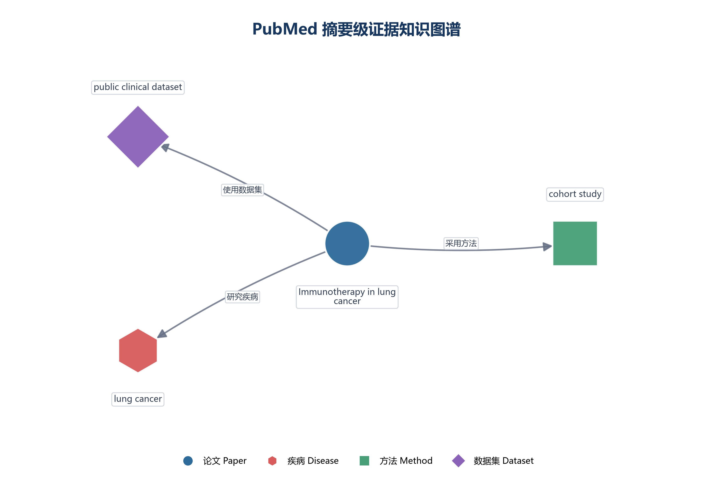

# Search Answer API

## 当前交付版本

**Stage 8D 本地可复现版**（基于 `v2.0-baseline` 继续完善）。

本版本以本地运行、证据可追溯和离线测试为目标，不要求安装 Docker、Redis 或部署
PostgreSQL + pgvector。相关代码可以保留，但不把尚未完成的外部服务部署验证描述成已完成能力。

## 当前状态

当前状态：阶段 0～8D 已完成（Docker 部署保持可选）。

- 已实现：PubMed 富元数据检索、Embedding、关键词 + 向量混合检索和本地持久化向量索引。
- 已实现：`/evidence` 摘要级证据接口、PMID/标题/摘要原文片段追踪和严格证据校验。
- 已实现：`/compare` 多文献比较接口，并标记校正文章、综述文章和摘要缺失。
- 已实现：`/answer` 可追溯回答和独立的 `/agent-answer` LangGraph Agent 接口。
- 已实现：查询改写、证据充分性判断、回答修复和引用检查的有界 Agent 流程。
- 已实现：PubMed 超时、有限重试、退避、候选结果缓存、请求 ID 和耗时日志。
- 已实现：结构化证据知识图谱、评测摘要、Swagger 示例和性能观察记录。
- 已实现：GitHub Actions 离线 unit 测试工作流和独立的 `api_runtime` 测试分类。
- 已验证：141 个离线 unit 测试通过；3 个外部 integration 测试默认跳过；35 个 `api_runtime` 测试单独标记。
- 已验证：Ollama `qwen2.5:3b` 本地回答、引用绑定和拒答流程。
- 已配置：GitHub Actions 离线 unit 测试工作流；真实 PubMed、Ollama 和数据库服务不在 CI 中自动启动。
- 当前边界：pgvector 的代码和接口已保留，但本版本不承诺本机 PostgreSQL + pgvector 部署已验证。
- 当前边界：Docker、Redis 和并发压测暂不纳入本版本交付范围。

当前项目重点是可复现、可追溯和可测试，不把结构化引用检查描述成医学事实真伪判定。

引用检查现在可以把每个引用绑定到具体 PMID、标题/摘要片段和 `evidence_id`；它仍然不替代医学事实真伪判断。

这是一个用于学习“检索增强问答（RAG）”的 FastAPI 项目。当前版本先完成稳定的基础层：

- `/health`：健康检查
- `/search`：本地 JSON 文档检索，或检索 PubMed
- `/search` 的 `source` 还支持 `vector`，用于本地 Embedding 向量检索
- `/search` 新增 `vector_pg` 和 `hybrid_pg`，用于 PostgreSQL + pgvector 持久化检索
- `/search` 的 `source` 支持 `pubmed_hybrid`，先召回 PubMed 文献，再使用关键词 + 向量排序
- `/answer`：根据检索结果返回带来源编号的回答
- `/evidence`：PubMed 混合召回后，返回只基于标题/摘要的结构化证据 JSON
- `/compare`：比较多篇 PubMed 文献，并返回结构化证据和文章质量标记
- 本地文档从 `data/documents.json` 读取，不再写死在 Python 文件里
- PubMed 请求带超时、HTTP 异常处理和自动化测试

## 项目架构

项目主线是“PubMed 摘要召回 → 混合排序 → 证据结构化 → 可追溯回答 → 文献比较 → 轻量证据图谱”：

```mermaid
flowchart LR
    Q[用户问题] --> API[FastAPI]
    API --> S{检索来源}
    S --> LOCAL[本地关键词检索]
    S --> VECTOR[本地 Embedding 检索]
    S --> PUBMED[PubMed ESearch / ESummary]
    LOCAL --> HYBRID[本地 hybrid]
    VECTOR --> HYBRID
    PUBMED --> PH[pubmed_hybrid]
    PH --> EVIDENCE[/evidence]
    PH --> COMPARE[/compare]
    PH --> AGENT["/agent-answer"]
    AGENT --> GATE[证据充分性门控]
    GATE -->|证据充分| LLM[Ollama grounded answer]
    GATE -->|证据不足| REWRITE[查询改写与有限重试]
    REWRITE --> PH
    LLM --> CITE[引用检查与回答修复]
    CITE --> OUT[回答 + PMID / evidence_id]
    EVIDENCE --> EXTRACT[摘要级证据提取]
    EXTRACT --> VALIDATE[PMID / 原文片段校验]
    VALIDATE --> ANSWER[/answer 与引用绑定]
    ANSWER --> OUT
    EXTRACT --> GRAPH[JSON 证据知识图谱]
```

其中 `hybrid` 只表示本地文档的关键词 + 向量检索，`pubmed_hybrid` 表示 PubMed 候选文献的混合排序，
两者语义保持独立。

## GitHub 快速入口

- [真实 Agent JSON 输出](examples/agent_answer_real.json)
- [六题人工检索评测报告](data/benchmark/retrieval_report_six_question_v1.md)
- [六题检索评测原始结果](data/benchmark/retrieval_benchmark_six_question_v1.json)

真实 Agent 输出是在 PubMed 接口恢复后，通过本地 Ollama `qwen2.5:3b` 运行得到的，
状态为 `completed`，包含 3 条引用绑定。README 只展示摘要字段；完整回答、PMID、
`evidence_id` 和执行轨迹请查看 JSON 文件。环境变量、邮箱和 API key 不写入示例文件。

示例摘要：

```json
{
  "status": "completed",
  "citations": [1, 3],
  "citation_binding_count": 3,
  "metadata": {
    "model": "qwen2.5:3b",
    "prompt_version": "grounded-answer-v3.5"
  }
}
```

## 使用 Python 3.11 环境

你当前已经创建好的环境在项目的 `.conda/search_api311` 目录中。若已经设置了 PowerShell 快捷函数，可以运行：

```powershell
api311
```

也可以直接激活：

```powershell
conda activate ".\.conda\search_api311"
```

然后安装依赖并运行测试：

```powershell
python -m pip install -r requirements.txt
python -m pip install -r requirements-rag.txt -r requirements-agent.txt
```

默认 unit 测试完全使用本地数据或 Mock，不访问 PubMed、PostgreSQL 或 Ollama：

```powershell
python -m pytest -m unit -q -p no:cacheprovider
```

外部 integration 测试位于 `tests/integration/`，默认只显示为跳过：

```powershell
python -m pytest -m integration -q -p no:cacheprovider
```

确认网络和 NCBI 配置后，显式开启联网测试：

```powershell
$env:RUN_PUBMED_INTEGRATION = "1"
python -m pytest -m integration -q
```

依赖 Starlette `TestClient` 的旧 API 运行测试单独标记为 `api_runtime`：

```powershell
python -m pytest -m api_runtime -q
```

这组测试需要兼容的 Starlette/httpx 运行环境；在当前 Windows 环境中默认不纳入离线 unit，
避免测试客户端阻塞被误认为业务失败。

pytest 临时目录固定在项目内的 `.pytest_tmp/`，不会再默认写入 C 盘临时目录。

启动开发服务器：

```powershell
python -m uvicorn app.main:app --reload
```

浏览器打开 <http://127.0.0.1:8000/docs>。

## 搜索示例

本地文档搜索：

```json
{
  "query": "Python 列表",
  "limit": 5,
  "source": "local"
}
```

PubMed 搜索：

```json
{
  "query": "lung cancer immunotherapy",
  "limit": 3,
  "source": "pubmed"
}
```

PubMed 混合排序：

```json
{
  "query": "lung cancer immunotherapy",
  "limit": 5,
  "candidate_limit": 30,
  "source": "pubmed_hybrid"
}
```

`hybrid` 继续只表示本地文档混合检索；`pubmed_hybrid` 才表示 PubMed 候选文献的混合排序。

PubMed 请求默认使用有限重试和内存缓存，可在 `.env` 中调整：

```text
PUBMED_TIMEOUT_SECONDS=15
PUBMED_MAX_RETRIES=2
PUBMED_RETRY_BACKOFF_SECONDS=0.25
PUBMED_CACHE_ENABLED=1
PUBMED_CACHE_TTL_SECONDS=300
PUBMED_CACHE_MAX_ENTRIES=128
PUBMED_HYBRID_CACHE_ENABLED=1
PUBMED_HYBRID_CACHE_TTL_SECONDS=300
PUBMED_HYBRID_CACHE_MAX_ENTRIES=128
```

缓存只保存在当前 API 进程内，重启服务后清空；它不会写入 C 盘或替代正式数据库缓存。
阶段 8B 的本地观测记录见
[examples/stage8b_latency_summary.json](examples/stage8b_latency_summary.json)。

本地向量检索需要先安装可选依赖：

```powershell
python -m pip install -r requirements-rag.txt
```

第一次使用 `source: "vector"` 时，会自动下载并缓存多语言 Embedding 模型
`paraphrase-multilingual-MiniLM-L12-v2`。在 Swagger 的 `/search` 中使用：

```json
{
  "query": "有序、可变的数据结构",
  "limit": 3,
  "source": "vector"
}
```

如果尚未安装可选依赖，接口会返回 `503`，而不是让整个服务崩溃。

### 持久化向量检索（阶段 3）

阶段 3 新增 `vector_pg`（持久化语义检索）和 `hybrid_pg`（关键词 + 持久化向量融合）。
现有 `vector`、`hybrid` 和 `pubmed_hybrid` 的含义保持不变。数据库启动、快照索引和
集成测试命令见 [STAGE3_PGVECTOR.md](STAGE3_PGVECTOR.md)。当前版本保留这部分实现，
但由于本机未固定 PostgreSQL + pgvector 运行环境，部署验证仍属于后续可选工作。

## 摘要级证据

`/evidence` 固定使用 `pubmed_hybrid` 检索。默认 `metadata_only` 模式不调用大模型，
用于先检查 PMID、标题证据和“摘要未提及”字段：

```json
{
  "question": "lung cancer immunotherapy",
  "top_k": 1,
  "candidate_limit": 20,
  "mode": "metadata_only"
}
```

如果已经配置 `LLM_API_KEY` 和 `LLM_MODEL`，可以使用 `strict_llm`。模型只能看到标题和摘要，
每个非空字段必须绑定 `evidence_ids`，每个 `exact_text` 必须逐字出现在标题或摘要中；
否则接口会拒绝返回，避免把未验证的推断当成证据。

```json
{
  "question": "lung cancer immunotherapy",
  "top_k": 1,
  "candidate_limit": 20,
  "mode": "strict_llm"
}
```

每条记录包含 `pmid`、`source_url`、`title`、`research_object`、`disease`、`method`、
`dataset`、`main_findings`、`limitations` 和 `evidence_spans`。摘要未提及的字段返回
`value: null`，并标记 `not_reported_in_abstract`；没有摘要时标记
`abstract_unavailable`。当前校验保证可追溯性，不替代医学事实核查。

完整的摘要证据返回示例见
[examples/evidence_response.json](examples/evidence_response.json)。
其中的 PMID 和文本是用于展示字段结构的演示数据，不代表实际医学结论。

## 文献比较

`/compare` 默认比较 2～5 篇 PubMed 文献：

```json
{
  "question": "lung cancer immunotherapy",
  "top_k": 3,
  "candidate_limit": 30,
  "mode": "metadata_only"
}
```

返回的 `comparison_table` 每行包含 PMID、标题、混合检索分数、结构化证据和 `markers`：

- `correction`：标题包含 Correction、Erratum、Retraction 等校正/撤稿提示；
- `review`：标题包含 Review、Systematic Review、Meta-analysis 等综述提示；
- `abstract_missing`：PubMed 没有摘要。

这些标记是透明的标题启发式和摘要是否存在检查，不会改变原有 `pubmed_hybrid` 分数，
也不会改变本地 `hybrid` 的含义。摘要缺失或未提及的比较字段仍然返回 `null`。

比较接口示例见
[examples/compare_response.json](examples/compare_response.json)。
其中的 PMID、标题和分数同样是演示数据，实际结果应以运行时 PubMed 返回为准。

## 引用验证

基础引用格式是 `[1]`。当一个来源只有一个证据片段时，系统可以自动绑定该片段；
当一个来源有多个片段时，必须使用精确格式：

```text
研究结果得到改善。[1:finding-1]
```

引用绑定结果会保留：

- `citation_number`
- `pmid`
- `evidence_id`
- `source_section`
- `exact_text`
- `source_url`

`citation_check_node` 和 `GroundedAnswerer(..., evidence_records=...)` 都会拒绝越界引用、
不存在的 `evidence_id`，以及无法唯一定位证据片段的 `[n]`。

## LangGraph Agent

`/agent-answer` 是独立的 Agent 演示接口，不改变原有 `/answer` 的行为。流程为：

```text
查询分析
→ 检索
→ 证据充分性判断
→ 必要时查询改写（最多 1 次）
→ 生成回答
→ 引用检查
→ 必要时回答修复（最多 1 次）
```

请求示例：

```json
{
  "question": "lung cancer immunotherapy",
  "retrieval_method": "pubmed_hybrid",
  "top_k": 3,
  "candidate_limit": 20,
  "metadata": {}
}
```

返回结果包括 `status`、`answer`、`citations`、`citation_bindings`、`attempt_count` 和 `trace`。
`trace` 用于展示每个节点的状态和耗时；`completed`、`abstained`、`failed` 三种状态明确区分
成功、证据不足和节点失败。Agent 测试使用本地假数据，不依赖 Ollama 或网络。

## 固定评测

固定问题保存在 `data/evaluation_questions.json`，当前包含 12 个医学检索问题。
在已经配置 PubMed 和 Embedding 环境的 PowerShell 中运行：

```powershell
python -m app.evaluation --mode metadata_only --top-k 3 --candidate-limit 20 --output evaluation_results.json
```

评测会记录：召回成功率、主题词匹配率、JSON 完整率、引用有效率、摘要证据覆盖率、
平均响应时间、模型调用次数和估计成本。`metadata_only` 基线不会调用大模型，因此
`llm_calls` 和成本为 0，摘要证据覆盖率为 0 是预期基线，不代表程序报错。

本次固定评测的摘要结果如下：

| 指标 | 结果 |
| --- | ---: |
| 固定问题数 | 12 |
| 检索成功率 | 100% |
| 主题词匹配率 | 100% |
| JSON 完整率 | 100% |
| 引用有效率 | 100% |
| 摘要证据覆盖率 | 0% |
| 平均响应时间 | 6493 ms |
| 大模型调用次数 | 0 |
| 估算成本 | 0 USD |

该结果是 `metadata_only` 基线：它只验证标题证据和结构完整性，不调用大模型，因此摘要证据覆盖率为 0
是预期结果。第一次请求包含 Embedding 模型加载，耗时会明显高于后续请求。完整摘要见
[examples/evaluation_summary.json](examples/evaluation_summary.json)。

阶段 6.1 还使用 Ollama 运行了 20 条回答与拒答评测：

| 指标 | 结果 |
| --- | ---: |
| 评测问题数 | 20 |
| Citation Precision | 1.000 |
| Citation Recall | 1.000 |
| Citation Coverage | 1.000 |
| Answer Faithfulness（词法代理指标） | 1.000 |
| Abstention Accuracy | 1.000 |
| Unsupported Claim Count 平均值 | 0 |
| Generation Error Cases | 0 |

该结果使用 assistant-draft 标签和词法代理指标，不等同于人工医学金标准或完整的语义蕴含评测；
原始记录位于 `artifacts/evaluation/answer_eval_v1_stage61_v35_real.json`。

## 固定候选池人工检索评测

对 `pubmed-snapshot-v1` 中 6 个完整标注问题、每题 20 篇候选文献进行了单人标注评测。
Recall/MRR 将 `relevance >= 1` 视为相关，nDCG 使用 0/1/2 分级标签。

| 方法 | Recall@1 | Recall@3 | Recall@5 | MRR | nDCG@5 | 平均查询延迟 |
| --- | ---: | ---: | ---: | ---: | ---: | ---: |
| Keyword | 0.045 | 0.136 | 0.268 | 0.889 | 0.639 | 2.04 ms |
| Vector | 0.066 | 0.198 | 0.309 | 1.000 | 0.895 | 21.91 ms |
| Hybrid | 0.066 | 0.198 | 0.309 | 1.000 | 0.896 | 17.17 ms |

在本候选池和标注范围内，Vector/Hybrid 的排序指标高于 Keyword；Hybrid 与 Vector 的召回接近，
nDCG@5 略高且查询延迟较低。该结果是固定候选池上的小规模人工评测，不代表 PubMed 全库召回率。
完整方法、质量标记、Bad Case 和局限性见
[retrieval_report_six_question_v1.md](data/benchmark/retrieval_report_six_question_v1.md)。

## 轻量证据知识图谱

`app/knowledge_graph.py` 只接受已经通过结构校验的 `StructuredEvidence`，不会从未验证的
自由文本猜测实体。当前包含四类节点：

- `Paper`：以 PMID 为唯一标识，并保留 PubMed 链接；
- `Method`：摘要中明确报告的方法；
- `Disease`：摘要中明确报告的疾病；
- `Dataset`：摘要中明确报告的数据集。

论文与方法、疾病、数据集之间的每条关系都保留 `pmid`、`evidence_id`、
`source_section`、`evidence_text` 和 `source_url`。摘要未提及的字段不会创建节点或关系，
因此图谱不会把 `null` 当作事实。当前使用纯 JSON，不需要安装 NetworkX 或 Neo4j：

```python
from app.knowledge_graph import build_evidence_graph, write_graph_json

# records 应来自 /evidence 的结构化结果，或 EvidenceExtractor.extract() 的结果列表
graph = build_evidence_graph(records)
write_graph_json(graph, "artifacts/evidence_graph.json")
print(graph.paper_count, graph.relation_count)
```

输出文件可以直接作为 GitHub 展示样例或后续可视化的输入。它是证据图谱，不是完整医学知识图谱；
当前不做全文推断、实体链接、Neo4j 部署或 GraphRAG。

示例图谱文件见
[artifacts/evidence_graph_demo.json](artifacts/evidence_graph_demo.json)，可视化结果见：



上面的 PNG 是可选展示产物；生成图片时才需要额外安装 `networkx` 和 `matplotlib`，它们不是 API 运行时依赖。

重新生成 PNG：

```powershell
python examples/plot_knowledge_graph.py
```

## GitHub 展示与复现

建议按下面顺序演示项目：

```powershell
api311
cd D:\Codex\medical-evidence-agent\python_proj\search_api
python -m pytest -m unit -q -p no:cacheprovider
python -m uvicorn app.main:app --reload
```

浏览器打开 <http://127.0.0.1:8000/docs>，依次演示：

1. `/health`：服务正常；
2. `/search`：`source="pubmed_hybrid"`，展示 PubMed 检索和混合排序；
3. `/agent-answer`：展示 LangGraph 节点轨迹、回答和精确引用；
4. `/evidence`：展示 PMID、标题证据和摘要缺失字段；
5. `/compare`：展示多篇文献比较及校正/综述/摘要缺失标记；
6. 运行知识图谱示例代码，展示 JSON 和 PNG 输出。

性能演示可以对相同的 `/agent-answer` 请求连续调用两次：第一次体现 PubMed/Embedding
冷启动，第二次体现混合检索和回答缓存。不要把缓存命中后的延迟当成 PubMed 全库检索速度。

固定评测命令：

```powershell
python -m app.evaluation `
  --mode metadata_only `
  --top-k 3 `
  --candidate-limit 20 `
  --output evaluation_results.json
```

## 项目局限性

- 当前证据主要来自 PubMed 标题和摘要，不读取全文；
- `metadata_only` 不做语义字段提取，摘要中的研究对象、方法和发现会保持 `null`；
- `strict_llm` 需要配置大模型接口，并且只保证原文片段可追溯，不等于完成医学事实真伪判定；
- PubMed 结果和响应时间会随网络、NCBI 服务和 Embedding 模型加载状态变化；
- 当前知识图谱使用 JSON，不做实体链接、同义词归一化、Neo4j 部署或完整 GraphRAG；
- 项目用于学习和演示 RAG 工程流程，不替代医生、研究者或正式系统的医学判断。

评测程序生成的 `evaluation_results.json` 是本地原始记录，已加入 `.gitignore`；仓库保留经过说明的
`examples/evaluation_summary.json`。知识图谱演示 Notebook 位于
`examples/demo_knowledge_graph.ipynb`，不参与 pytest 测试收集。

PubMed 连接使用 NCBI E-utilities 的 ESearch 和 ESummary。NCBI 建议在程序化访问时提供联系邮箱；可以在 PowerShell 中设置：

```powershell
$env:NCBI_EMAIL = "your-email@example.com"
# 如果有 NCBI API key，再设置：
# $env:NCBI_API_KEY = "your-api-key"
```

## Git 初始化

```powershell
git init
git add .
git commit -m "chore: initialize search API project"
```

## 路线完成度与后续工作

当前主线已经完成：

```text
PubMed 摘要召回
→ 关键词/向量混合排序
→ 摘要级证据结构化
→ 可追溯回答与拒答
→ 文献比较
→ 轻量证据知识图谱
→ LangGraph Agent 编排
→ 超时、重试、缓存、请求 ID 和测试隔离
```

阶段 8D 的 GitHub Actions 只运行离线 unit 测试；真实 PubMed、PostgreSQL 和 Ollama 测试继续保持显式开启，
避免 CI 因外部服务变化而产生不可复现结果。后续如需生产化，可再考虑 Redis、异步 PubMed 客户端、
更严格的语义蕴含评测和实体链接，但这些不属于当前可复现基线。

## 两个项目的能力链

两个项目目前是相互独立的项目，不表示项目一的数据已经接入项目二；它们共同体现一条完整的 AI 数据与应用质量链：

```text
项目一：网页数据质量与评测 Pipeline
HTML 正文抽取 → 去重 → 质量评分 → keep / review / reject → Benchmark 与 Bad Case
                                      ↓
项目二：医学证据 RAG 与 Agent 评测系统
PubMed 摘要召回 → 关键词/向量混合排序 → 结构化证据 → PMID 引用校验 → 证据不足拒答
```

这条能力链对应三个问题：输入数据是否可靠、检索结果是否相关、模型回答是否有证据支持。
项目一侧重输入端数据质量，项目二侧重检索端和输出端的可追溯性。

### 本版本暂不纳入

- Docker 镜像和 Docker Compose 部署验证；
- Redis 分布式缓存；
- PostgreSQL + pgvector 的本机部署验收；
- 真实外部服务的 GitHub Actions 集成测试；
- 面向 PubMed 的高并发压测。

这些事项不会影响当前本地 API、Embedding、混合检索、证据结构化、引用检查和 Agent 演示。
如果后续需要生产化，再单独建立部署环境和验收记录，避免把开发机上的缓存命中或本地运行结果误写成服务端性能指标。

Embedding 和大模型均使用显式配置的本地路径或 OpenAI 兼容接口；项目不会在 API 请求过程中自动下载模型。
# 升级说明

阶段升级模块已经接入原项目。接口请求示例与配置说明见 [UPGRADE_GUIDE.md](UPGRADE_GUIDE.md)。

